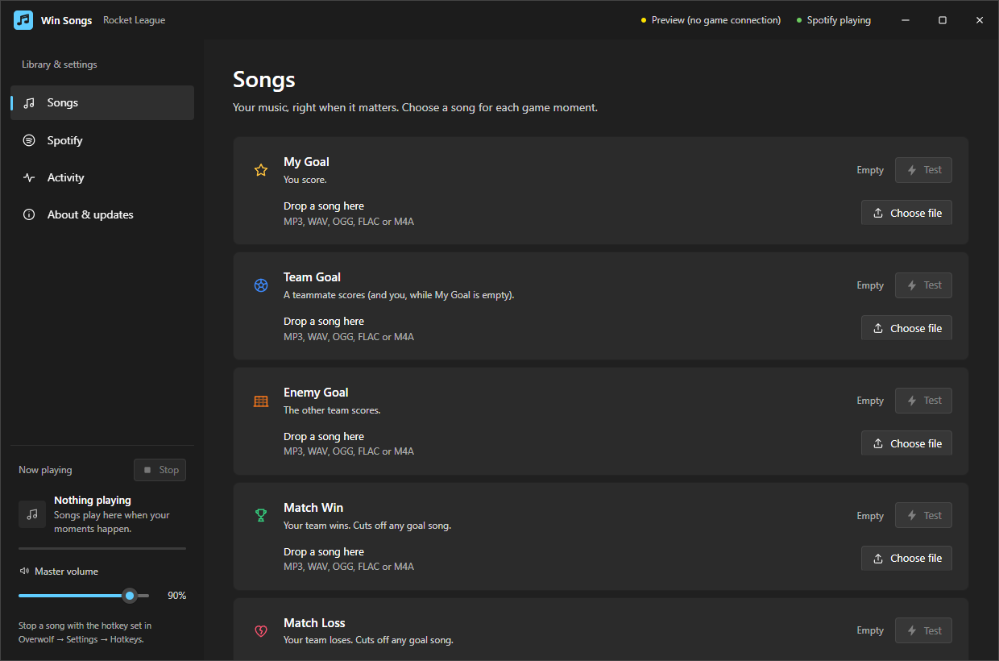

# Win Songs

Play your own music when you score, win, or lose. Win Songs trims your favorite tracks into game-moment clips and fades Spotify out and back in around them.

**[Download the latest release](https://github.com/Foptciy/win-songs/releases/latest)**

## Install

1. Download **WinSongs-Setup-X.Y.Z.exe** from the release page and run it.
2. Launch Win Songs. For Rocket League, use **Turn it on** if the Stats API setup card appears, then restart the game.
3. Add songs to your moments and try **Test**. An empty moment plays nothing.

Requires Windows 10 version 2004 or later / Windows 11, x64 compatible, .NET Framework 4.8, and the [Microsoft Edge WebView2 Runtime](https://developer.microsoft.com/microsoft-edge/webview2/). Windows may show a SmartScreen warning because the installer is currently unsigned.

Closing the window keeps songs running in the tray. Right-click the tray icon to quit. **Ctrl+Shift+E** stops the song; **Ctrl+Shift+R** shows or hides the window.

## Builds

| Download | Includes | Updates |
| --- | --- | --- |
| Windows installer | Rocket League, using its built-in Stats API | Automatic |
| Portable ZIP | Same Rocket League app; extract and run WinSongs.exe | Manual |
| Overwolf ZIP | Rocket League and VALORANT | Managed by Overwolf |

The Overwolf build currently requires a developer-approved Overwolf account to load unpacked. It is not an Overwolf store release.

## Automatic updates

The installed app checks this public repository shortly after launch and every six hours. It verifies the download size and SHA-256, then installs and reopens when no match, song, preview, or recent editing is active. Your library and settings remain in `%LOCALAPPDATA%\WinSongs`.

Use **About & updates** or the tray menu to check manually. You can turn automatic installation off in About. No GitHub login is needed to download or update.

## Moving from HypeTrack

Quit HypeTrack from its tray before launching Win Songs for the first time. Win Songs copies the old standalone library into its new data folder and leaves the original intact. The Overwolf rename creates a new app identity; previous Overwolf libraries do not migrate automatically.

## Features

- Goals, round results, match results, and Rocket League tournament warmup.
- Saved songs for every moment, random selection, and warmup queues.
- Waveform trimming, exact start/end times, delay, volume, and fades.
- Spotify pause or duck mode, crossfade, and crash recovery.
- Event simulation and activity logs for troubleshooting.

Tournament warmup detection needs confirmation in a live tournament. Win Songs is an independent app and is not affiliated with the game publishers, Spotify, Microsoft, or Overwolf.

This public repository holds download documentation and release assets. Source development is maintained separately in a private repository. GitHub's automatically generated “Source code” archives contain only this public documentation; use the installer or ZIP assets above to get the app.

Report problems in [Issues](https://github.com/Foptciy/win-songs/issues), including your version and relevant Activity entries. Do not attach personal audio files or private information.
